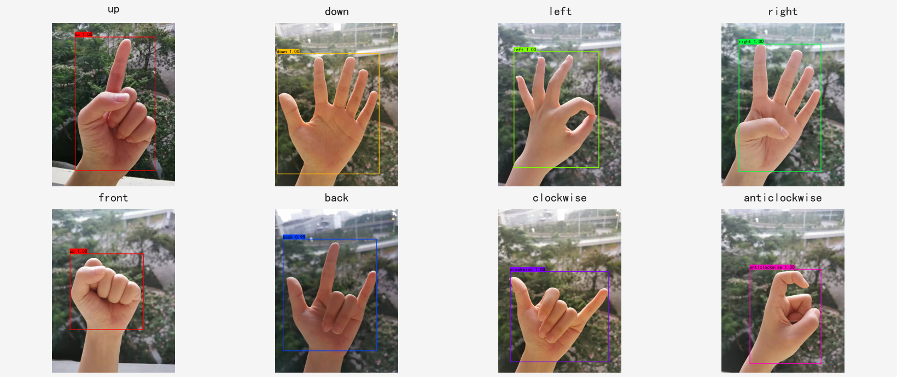
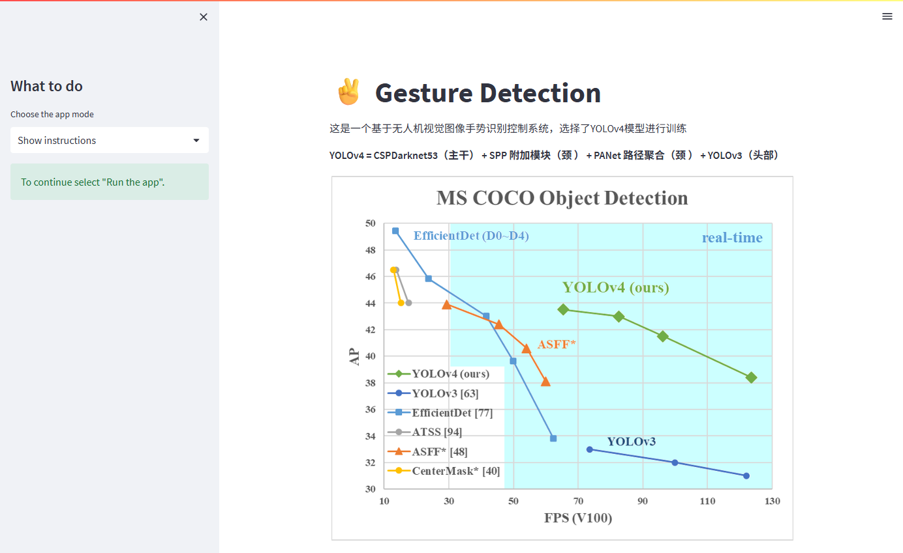
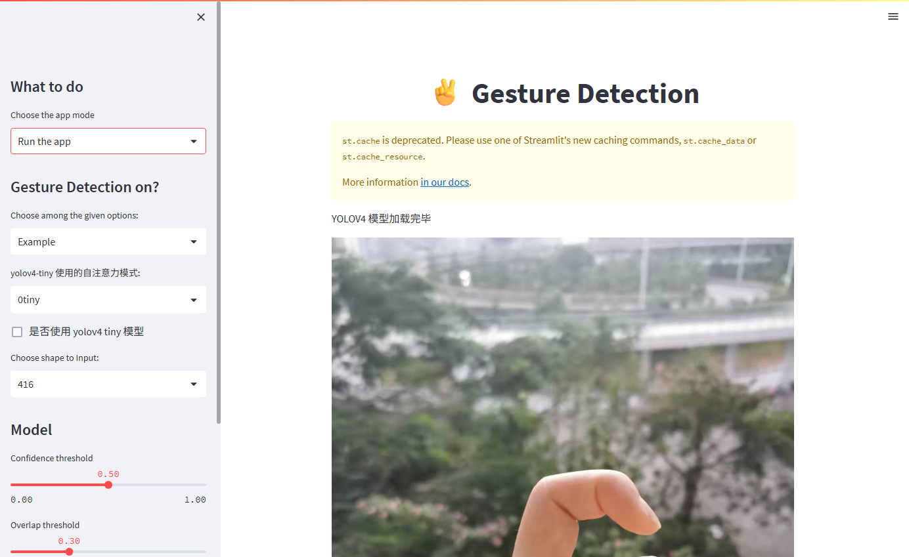
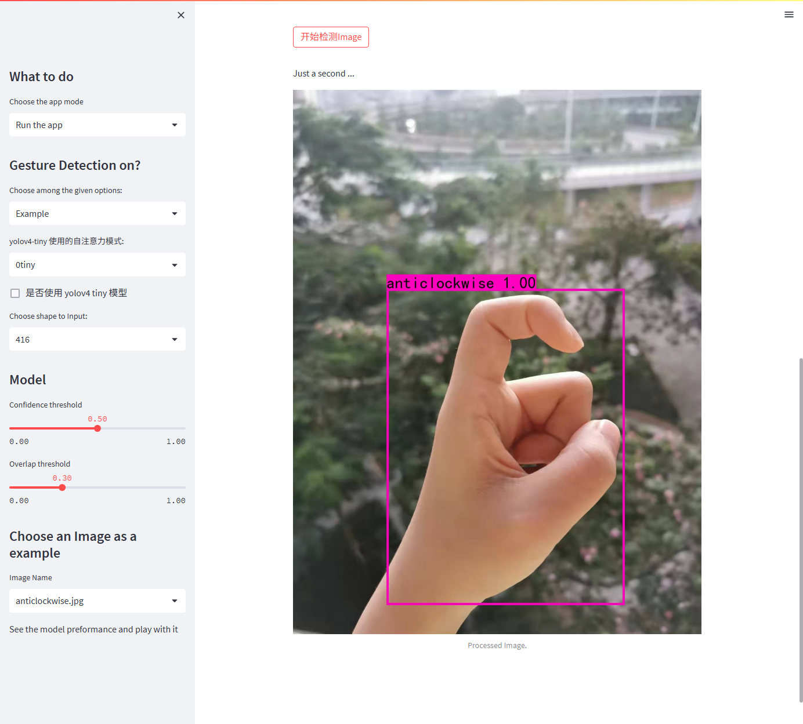
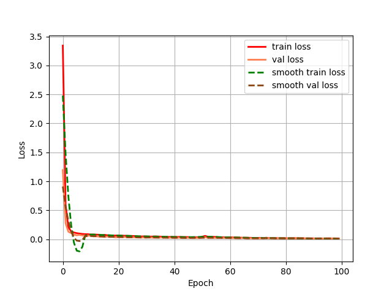
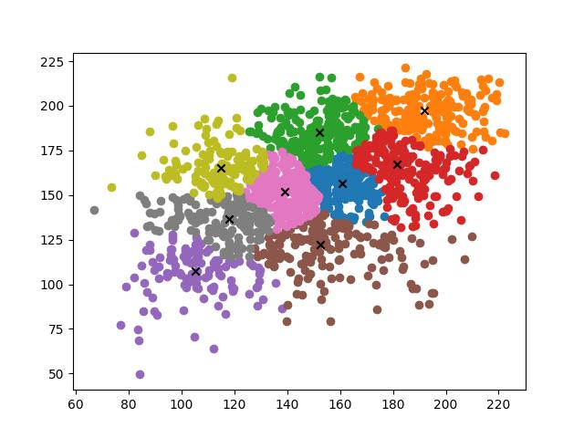

# YoloGesture — 基于 YOLOv4 的无人机手势识别控制系统
# 源码获取：https://mbd.pub/o/bread/YZaWl5dyZw==



面向**无人机视觉图像**的手势识别控制系统：由机载摄像头拍摄地面操作人员的手势，模型实时识别手势类别并输出对应的飞控指令，实现无遥控器的非接触式操控。

基于 **YOLOv4 / YOLOv4-tiny**，覆盖 **数据标注 → 训练 → 评估 → 部署** 全流程：

- **8 类飞控手势**实时检测：`up / down / left / right / front / back / clockwise / anticlockwise`
- **主模型 mAP@0.5 达 98.35%**（416 输入，150 epochs）
- 提供命令行推理、mAP 评估、FPS 测试、热力图、ONNX 导出等 6 种模式
- 内置 **Streamlit Web 应用**，支持摄像头 / 图片 / 视频多种检测方式
- 支持 **SE / CBAM / ECA / CA** 四种注意力机制的轻量化变体，适配机载算力受限场景

**模型结构**：`YOLOv4 = CSPDarknet53（主干） + SPP（颈部） + PANet（颈部） + YOLOv3（检测头）`


---

## 手势与飞控指令映射

| 手势 | 飞控含义 |
| --- | --- |
| `up` / `down` | 上升 / 下降 |
| `left` / `right` | 左移 / 右移 |
| `front` / `back` | 前进 / 后退 |
| `clockwise` / `anticlockwise` | 顺时针 / 逆时针偏航（旋转） |

> 实际部署时可在此基础上叠加安全策略（如连续 N 帧确认、置信度阈值、失控保护）后再下发指令。手势含义可按业务需要重新定义，只需同步修改 `model_data/gesture.yaml` 的 `classes`。

---

## 目录

- [1. 运行效果](#1-运行效果)
- [2. 数据集](#2-数据集)
- [3. 环境配置](#3-环境配置)
- [4. 快速开始](#4-快速开始)
- [5. 训练](#5-训练)
- [6. 评估](#6-评估)
- [7. 实验结果](#7-实验结果)
- [8. Streamlit Web 部署](#8-streamlit-web-部署)
- [9. 项目结构](#9-项目结构)
- [10. 常见问题](#10-常见问题)
- [11. 参考](#11-参考)

---

## 1. 运行效果

### 1.1 命令行批量检测

对 `img/` 下 8 张无人机视角手势图片使用主权重 `yolov4_weights_ep150_416.pth` 推理，结果保存至 `img_out/`：

| 类别 | up | down | left | right | front | back | clockwise | anticlockwise |
| :--: | :-: | :--: | :--: | :---: | :---: | :--: | :-------: | :-----------: |
| 置信度 | 1.00 | 1.00 | 1.00 | 1.00 | **误检为 up** | 0.99 | 1.00 | 1.00 |

> front（握拳正面）样例被误检为 up，是该数据集的历史难点（见 [实验结果](#7-实验结果)），其余 7 类均高置信度正确检出。

检测结果拼图：


### 1.2 Web 界面（Streamlit）

说明页：



检测界面：



实时检测结果：



### 1.3 训练损失曲线



### 1.4 Anchor K-Means 聚类



### 1.5 FPS 测试（CPU 实测）

```text
# python predict.py --tiny --phi 0 --weights model_data/yolov4_tiny.pth --mode fps
0.0565 seconds, 17.71 FPS, @batch_size 1   # Intel CPU 单线程推理
```

> 完整输出见 [screenshots/fps_test_output.txt](screenshots/fps_test_output.txt)；GPU 下帧率会显著更高。

---

## 2. 数据集

采用 **PASCAL VOC 格式**，8 类手势，目录结构：

```text
VOCdevkit/VOC2007/
├── JPEGImages/   # 图片（.jpg，非 jpg 后缀需先批量转换）
└── Annotations/  # LabelImg 标注（.xml，与图片同名对应）
```

| 类别 | 含义 |
| --- | --- |
| up / down / left / right | 上 / 下 / 左 / 右 方向手势 |
| front / back | 手势正面 / 背面 |
| clockwise / anticlockwise | 顺时针 / 逆时针 旋转手势 |

- 图像采集自**无人机视角**，包含不同距离、光照与背景下的地面人员手势，覆盖机载视觉的实际成像条件
- 完整数据集约 1600 张；本仓库为便于分发，`VOCdevkit` 内仅内置少量示例图片
- 更大规模公开手势数据集可参考 [HaGRID](https://github.com/hukenovs/hagrid)（18 类），但需注意其为人手近景拍摄，与无人机视角差异较大
- 数据增广经验：Mosaic 在小数据集上收益有限，最终未采用；输入分辨率由 256 提升至 **416**（兼顾小目标与机载实时性）

---

## 3. 环境配置

- Python ≥ 3.7
- PyTorch 1.8.x（`torch==1.8.1` / `torchvision==0.9.1`，更高版本通常兼容）

```bash
git clone https://github.com/Kedreamix/YoloGesture.git
cd YoloGesture
pip install -r requirements.txt -i https://pypi.tuna.tsinghua.edu.cn/simple/
```

主要依赖：`torch`、`opencv-python`、`Pillow`、`matplotlib`、`pyyaml`、`tensorboard`、`streamlit`、`labelimg`。

---

## 4. 快速开始

### 4.1 生成训练清单

读取 `VOCdevkit` 下的图片与标签，生成 `2007_train.txt` / `2007_val.txt`：

```bash
python voc_annotation.py
```

> 划分比例在脚本内配置：`trainval_percent`（(训练+验证):测试，默认 1 即不单独留测试集）、`train_percent`（训练:验证 = 0.9）。

### 4.2 （可选）计算 Anchors

```bash
python kmeans_for_anchors.py     # 输出 kmeans_for_anchors.jpg 与 yolo_anchors.txt
```

### 4.3 命令行推理（`predict.py`）

```bash
# 批量检测 img/ 全部图片 → img_out/（主权重，mAP 98.35%）
python predict.py --weights yolov4_weights_ep150_416.pth --mode dir_predict

# 轻量 tiny 模型批量检测
python predict.py --tiny --phi 0 --weights model_data/yolov4_tiny.pth --mode dir_predict

# 单张图片交互式预测
python predict.py --weights yolov4_weights_ep150_416.pth --mode predict

# 视频 / 摄像头检测（--video 为空则调用摄像头），可 --save-video 保存结果
python predict.py --weights yolov4_weights_ep150_416.pth --mode video --video test.mp4 --save-video out.mp4

# FPS 测试
python predict.py --tiny --phi 0 --weights model_data/yolov4_tiny.pth --mode fps

# 热力图（观察模型关注区域）
python predict.py --weights yolov4_weights_ep150_416.pth --mode heatmap

# 导出 ONNX
python predict.py --weights yolov4_weights_ep150_416.pth --mode export_onnx
```

| 参数 | 默认值 | 说明 |
| --- | --- | --- |
| `--mode` | `dir_predict` | `predict / video / fps / dir_predict / heatmap / export_onnx` |
| `--weights` | `model_data/yolov4_tiny.pth` | 权重路径 |
| `--tiny` | 关闭 | 使用 yolov4-tiny 轻量模型 |
| `--phi` | 1 | tiny 模型注意力机制：0=无，1=SE，2=CBAM，3=ECA，4=CA |
| `--shape` | 416 | 输入尺寸（须为 32 的倍数） |
| `--confidence` | 0.5 | 置信度阈值 |
| `--nms_iou` | 0.3 | NMS IoU 阈值 |
| `--cuda` | 关闭 | 使用 GPU |

---

## 5. 训练

```bash
# yolov4-tiny + SE 注意力，冻结迁移学习（前 50 epoch 冻结主干）
python train.py --tiny --phi 1 --epochs 100 \
    -w model_data/yolov4_tiny.pth \
    -f -fe 50 -fb 8 \
    -bs 4 --shape 416 --fp16 --cuda

# 快速验证脚本是否跑通
python train.py --tiny --phi 1 --epochs 10 -bs 4 --shape 416 --cuda
```

常用参数：

| 参数 | 默认值 | 说明 |
| --- | --- | --- |
| `--epochs` | 100 | 训练轮数 |
| `-w / --weights` | 空 | 初始权重路径 |
| `--tiny` | 关闭 | 使用 yolov4-tiny |
| `--phi` | 0 | tiny 注意力机制：0=无，1=SE，2=CBAM，3=ECA，4=CA |
| `-f / --freeze` | 关闭 | 冻结训练（迁移学习） |
| `-fe / --freeze-epochs` | 50 | 冻结轮数 |
| `-fb / --freeze-size` | 32 | 冻结阶段 batch size |
| `-bs / --batch-size` | 10 | 训练 batch size |
| `--optimizer` | adam | `sgd / adam / adamw` |
| `--lr` | 0.02 | 初始学习率 |
| `--shape` | 416 | 输入尺寸（32 的倍数） |
| `--fp16` | 关闭 | 混合精度训练，约省一半显存 |
| `--mosaic` | 关闭 | Mosaic 数据增强（小数据集不建议） |
| `-save / --save-period` | 4 | 每 N 个 epoch 保存一次权重 |
| `-r / --resume` | 关闭 | 断点续传 |
| `--cuda` | 关闭 | 使用 GPU |

训练配置集中在 `model_data/gesture.yaml`（类别数 `nc`、类别名、置信度、NMS、`num_workers`、学习率衰减方式等）。

- 权重每 `save-period` 个 epoch 保存到 `logs/`
- 损失曲线在 `logs/loss_*` 目录，TensorBoard 查看：`tensorboard --logdir=logs/`
- 网络结构概览：`python summary.py`

### 训练自己的数据集

1. 图片放入 `VOCdevkit/VOC2007/JPEGImages`，LabelImg 标注放入 `VOCdevkit/VOC2007/Annotations`
2. 修改 `model_data/gesture.yaml` 的 `nc` 与 `classes`（训练、推理、标注清单均读取该配置）
3. `python voc_annotation.py` 生成清单 → `python train.py ...`
4. 权重在 `logs/`，用 `predict.py` / `get_map.py` 验证

### 半自动标注（可选）

先训练一个初版权重，再用 `detect.py` 对批量图片预测生成 Labelme 格式预标注（路径在 `gesture.yaml` 的 `dir_detect_path` / `detect_save_path`），人工修正后可大幅减少标注工作量。

---

## 6. 评估

```bash
# 验证集计算 mAP，结果输出到 map_out/（PR 曲线、各类别 AP 等）
python get_map.py --weights yolov4_weights_ep150_416.pth --cuda

# tiny 模型
python get_map.py --tiny --phi 1 --weights model_data/yolov4_tiny.pth --cuda
```

| 参数 | 默认值 | 说明 |
| --- | --- | --- |
| `--mode` | 0 | 评估模式（0：完整评估流程） |
| `--shape` | 416 | 输入尺寸，需与训练一致 |
| `--confidence` | 0.5 | 置信度阈值 |
| `--nms_iou` | 0.3 | NMS IoU 阈值 |

输出包括：召回率、精确率、PR 曲线、各类别 AP 与 mAP@0.5、mAP@0.5:0.95。

---

## 7. 实验结果

| 数据集 | 权重 | Epochs | Batch | Input | mAP@0.5 | mAP@0.5:0.95 |
| :--: | :--: | :--: | :--: | :--: | :--: | :--: |
| Gesture v3 | `yolov4_weights_ep150_416.pth` | 150 | 64→32 | 416 | **98.35%** | 95.15% |
| Gesture v3 | `yolov4_weights_ep150_608.pth` | 150 | 64→32 | 608 | 97.23% | 93.64% |
| Gesture v3 | `yolov4_CBAM.pth` | 150 | 64→32 | 416 | 94.97% | 91.09% |
| Gesture v3 | `yolov4_ECA.pth` | 150 | 64→32 | 416 | 83.24% | 94.58% |
| Gesture v3 | `yolov4_tiny.pth` | 150 | 64→32 | 416 | 91.30% | 75.05% |
| Gesture v3 | `yolov4_SE.pth` | 150 | 64→32 | 416 | 90.13% | 78.06% |

- **数据集版本**：v1 存在标注问题效果较差 → v2 重修数据集 → v3 修正 front 手势后平均精度明显提升
- **Batch 64→32**：前段冻结训练 bs=64，后段解冻训练 bs=32
- **注意力机制结论**：CBAM 在精度与速度间平衡较好；tiny 速度最快（速度-精度 trade-off）；优化器上 Adam 优于 SGD
- 本仓库根目录已包含上述全部权重文件，可直接加载

---

## 8. Streamlit Web 部署

### 本地运行

```bash
pip install streamlit
streamlit run gesture.streamlit.py
```

打开 `http://localhost:8501`（应用会自动校验 / 下载缺失权重到根目录）。

### 页面模式

侧边栏 `Choose the app mode`：

| 模式 | 说明 |
| --- | --- |
| Show instructions | 说明页（读取 `instructions.md`） |
| Run the app | 进入检测应用 |
| Show the source code | 查看应用源码 |

### 检测模式（Run the app 内）

| 模式 | 说明 |
| --- | --- |
| Example | 内置示例图片检测 |
| Image | 上传图片检测 |
| Camera | 摄像头实时检测，可拍照测 FPS / Heatmap |
| FPS | 上传图片测推理帧率 |
| Heatmap | 热力图可视化 |
| Video | 上传视频检测并下载结果 |

### 模型与参数

- 侧边栏可选 5 种模型：**yolov4 / tiny / SE / CBAM / ECA**，输入 shape **416 / 608**
- 注意力下拉框：`0tiny / 1SE / 2CABM / 3ECA`；选择 tiny 系列时须勾选「是否使用 yolov4 tiny 模型」
- 置信度（默认 0.5）与 NMS IoU（默认 0.3）滑杆可实时调节


---

## 9. 项目结构
```text
YoloGesture/
├── train.py                 # 训练入口（含冻结训练 / fp16 / 断点续传）
├── predict.py               # 推理：predict / video / fps / dir_predict / heatmap / export_onnx
├── get_map.py               # mAP 评估
├── voc_annotation.py        # VOC 标注 → 2007_train.txt / 2007_val.txt
├── kmeans_for_anchors.py    # Anchor K-Means 聚类
├── detect.py                # 半自动标注（生成 Labelme 预标注）
├── gen_annotation.py        # VOC XML 标注生成工具
├── summary.py               # 打印网络结构（torchinfo）
├── get_yaml.py              # 读取 model_data/gesture.yaml 配置
├── yolo.py                  # YOLO 推理封装（加载权重、解码、NMS）
├── gesture.streamlit.py     # Streamlit Web 应用
├── instructions.md          # Web 应用说明页内容
├── nets/                    # 网络结构
│   ├── yolo.py / yolo_tiny.py        # YOLOv4 / tiny 主体
│   ├── CSPdarknet.py / CSPdarknet53_tiny.py
│   ├── attention.py                  # SE / CBAM / ECA / CA
│   └── yolo_training.py / yolotiny_training.py  # 损失与训练调度
├── utils/                   # 数据加载、DecodeBox、mAP、回调等
├── model_data/              # gesture.yaml、类别、anchors、tiny 权重
├── VOCdevkit/               # VOC 格式数据集
├── logs/                    # 训练日志与损失曲线
├── img/  img_out/           # 测试图片与检测结果
├── screenshots/             # README 运行截图
└── *.pth                    # 预训练权重（416 / 608 / SE / CBAM / ECA / tiny）
```

---

## 10. 常见问题

- **训练报错找不到目标**：先确认 `python voc_annotation.py` 已生成 `2007_train.txt`，且行内包含坐标信息
- **输入尺寸报错**：`--shape` 必须是 32 的倍数，且评估 / 推理尺寸应与训练一致
- **Windows 读取数据卡顿**：把 `gesture.yaml` 的 `num_workers` 调为 0
- **显存不足**：减小 `-bs`、开启 `--fp16`，或使用 `--tiny` 轻量模型
- **损失不收敛**：先看验证损失是否还在下降（接近 0 不是目标），再考虑调 `--lr`、`--optimizer`

---

## 11. 参考

- [bubbliiiing/yolov4-pytorch](https://github.com/bubbliiiing/yolov4-pytorch)
- [qqwweee/keras-yolo3](https://github.com/qqwweee/keras-yolo3/)
- [Ma-Dan/keras-yolo4](https://github.com/Ma-Dan/keras-yolo4)

---

如果本项目对你有帮助，欢迎 Star ⭐ 支持；问题欢迎在 Issue 中讨论。
